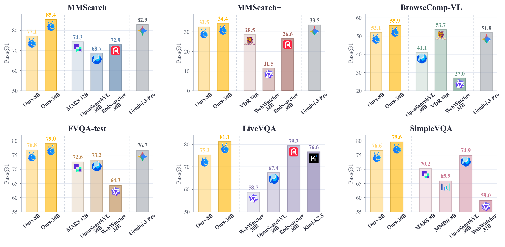
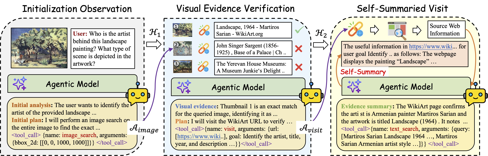
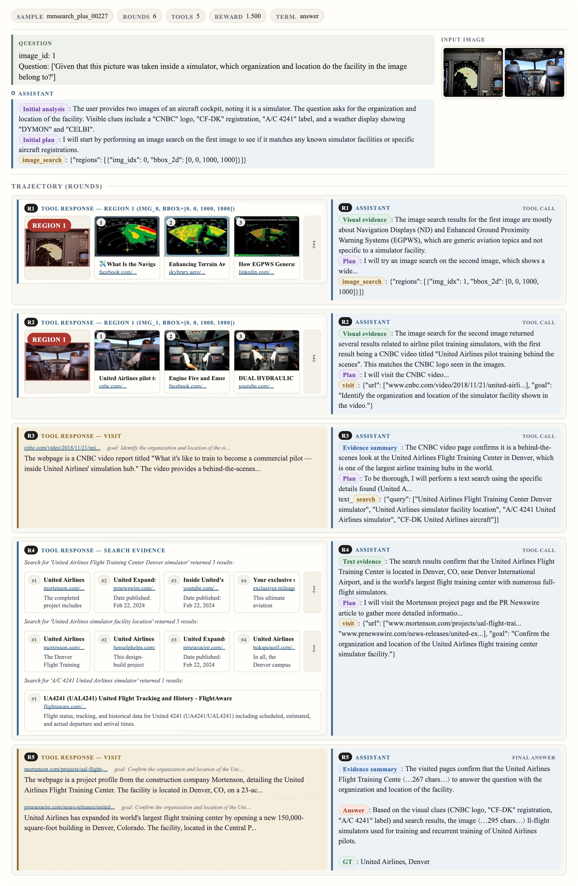

<div align="center">

# SimpleSearch-VL: A Simple Agentic System for Multimodal Deep Search Agents


**Evidence-Verified SFT · Factorized Adaptive Rollout · Self-Summarized Visit**

[](https://arxiv.org/abs/2606.31504)

[](https://www.modelscope.cn/datasets/dmmm997/SimpleSearch-VL-SFT-5K)
[](https://www.modelscope.cn/datasets/dmmm997/SimpleSearch-VL-RL-2K)
[](https://www.modelscope.cn/datasets/dmmm997/SimpleSearch-VL-EvalData)

[](https://www.modelscope.cn/models/dmmm997/SimpleSearch-VL-8B)
[](https://www.modelscope.cn/models/dmmm997/SimpleSearch-VL-30B-A3B)


</div>

SimpleSearch-VL is a simple agentic system for **multimodal deep search**, training visual-language agents to actively search the web, perform region-level reverse image search, visit evidence pages, verify retrieved evidence, and produce grounded answers.
Beyond the agent recipe, this repository provides a practical **multimodal agentic RL training infrastructure**: tool-interleaved rollout generation, cache-aware online retrieval, and **Factorized Adaptive Rollout (FAR)** for efficient signal-aware RL training.
With Qwen3-VL backbones, SimpleSearch-VL obtains strong performance across six multimodal search benchmarks with only 5K SFT trajectories and 2K RL prompts. Instead of simply scaling data, adding more tools, or relying on extra auxiliary models, we build higher-quality evidence-aware trajectories, make visual search results directly verifiable, and use FAR to extract stronger RL signal from a small training budget.



## ✨ Highlights

- **Factorized Adaptive Rollout (FAR)**: factorizes rollout budget into **prompt expansion** and **rollout allocation**, spending extra attempts on hard prompt groups while skipping redundant tail rollouts once useful reward variation appears.
- **Evidence-verified reasoning**: trains the agent to **verify textual evidence** and to **check matched thumbnails** from region-level reverse image search before trusting titles, URLs, or webpage evidence.
- **Self-summarized visit**: keeps webpage summarization **inside the policy model**, so training and inference do not require deploying an additional summary model.
- **Minimal engineering dependencies**: relies only on **Serper**, **JINA Reader**, and **OSS** for online search, webpage reading, and image-region upload, yet can train a strong multimodal search agent.
- **Data- and compute-efficient training**: trains 8B and 30B-A3B variants with only **5K SFT trajectories** and **2K RL prompts**, requiring roughly **1-2 days on a single 8xH200 node**; the paper reports **+15.8** and **+16.0** average points over corresponding Qwen3-VL agentic baselines.
- **Strong benchmark results**: SimpleSearch-VL-30B-A3B **outperforms agentic Gemini-3-Pro** on MMSearch, MMSearch+, BrowseComp-VL, FVQA, and LiveVQA.



## 📁 Repository Layout

```text
SimpleSearch-VL/
|-- data/
|   |-- SimpleSearch-VL/          # Dataset root used by this release
|-- checkpoints/                  # Local model checkpoint root, if provided
|-- README.md
|-- LICENSE
|-- figs/                         # README and paper figures
|-- rllm/
|   |-- .env                      # Runtime service configuration, created from .env.example
|   |-- simple_agentic_search/    # Agent workflow, tools, rewards, configs, RL launchers
|   |-- rllm/                     # rLLM runtime package
|   |-- verl/                     # verl-based trainer/runtime support
|-- ms-swift/                     # SFT training framework and launch scripts
|-- Megatron-LM/                  # Megatron-LM dependency snapshot
|-- mbridge/                      # Model bridge dependency snapshot
```

Set `PROJECT_ROOT` to the absolute path of your local SimpleSearch-VL checkout:

```bash
export PROJECT_ROOT=/path/to/SimpleSearch-VL
```

The canonical dataset root is then:

```text
$PROJECT_ROOT/data/SimpleSearch-VL
```

The RL/eval launchers resolve all paths **relative to `$PROJECT_ROOT/rllm`**, not relative to the YAML file. The provided configs therefore use `../data/SimpleSearch-VL/...`. A config copied into `config/local/` keeps the same path base.

## 🛠️ Installation

Create and activate a Python environment that matches your CUDA/PyTorch stack, then run the provided setup script from the repository root:

```bash
cd "$PROJECT_ROOT"

bash env_start.sh

# Also install the bundled SFT framework if you plan to run SFT.
python -m pip install -e ./ms-swift
```

The setup script installs `mbridge`, `Megatron-LM`, `rllm`, `verl`, and runtime utilities; it does **not** install `ms-swift`. The RL/eval launchers also require Bash 4.4+ and `rsync` for code snapshots. The bundled `rllm` package declares `aiosqlite`, which the search cache requires. Offline template checks need only Python and PyYAML (Hydra is additionally needed if passing overrides). We also provide a reference package snapshot from the reference runtime environment:

```text
$PROJECT_ROOT/pip_list_simplesearch_vl.txt
```

Use this file to check package versions when reproducing our setup. Depending on your platform, you may still need to adjust CUDA/PyTorch wheels and optional acceleration packages required by `verl`, `Megatron-LM`, and `ms-swift`.

## ⚙️ Runtime Configuration

The public YAML configs and `.env.example` contain **no usable credentials**. Blank required fields must be filled by the user; a template is not a ready-to-run experiment.

```bash
cd "$PROJECT_ROOT/rllm"

# Preserve the template and do not overwrite an existing local environment.
if [ ! -e .env ]; then
  (umask 077; cp .env.example .env)
fi
# Edit .env locally. It is a trusted Bash file: quote values, do not use <...> placeholders.
```

| Setting | When needed |
| --- | --- |
| `JUDGE_MODELS`, `JUDGE_BASE_URLS`, `JUDGE_API_KEYS` | All supplied RL/eval configs compute accuracy with a judge. Provide equal-length comma-separated lists with no empty entries. For a judge you explicitly know is unauthenticated, put a non-secret value such as `unused` in its key entry; the current client requires a value. Do not leave keys empty and rely on an unrelated `OPENAI_API_KEY`. |
| `SERP_API_KEY` | Required for `text_search` and online `image_search`. |
| `OSS_ACCESS_KEY_ID`, `OSS_ACCESS_KEY_SECRET`, `OSS_ENDPOINT`, `OSS_BUCKET_NAME` | Required for online `image_search`, including cache misses. Use your own endpoint/bucket and minimally scoped credentials. Remove `image_search` from `enabled_tools` if you cannot provide OSS. |
| `JINA_API_KEY` | Optional; an empty value makes unauthenticated Reader requests, subject to service limits. When set, this client forwards it as the complete `Authorization` header; include the service-required scheme (for example, `Bearer`). |
| `EXTRACT_MODEL` | Defaults to `self`: the policy model summarizes visited pages. An external summarizer requires an explicit model and a full `EXTRACT_URL` ending in `/v1/chat/completions`, plus `EXTRACT_KEY` (complete `Authorization` header value) if its service requires authentication. |
| `AGENT_API_KEY` | API-model evaluation only. Separate from judge/search/reader credentials; selected by `agent_model_api.api_key_env`. |

`run.sh` loads `rllm/.env` by default. Set `SIMPLESEARCH_ENV_FILE=/absolute/path/to/private.env` to use a different trusted file, or set `SIMPLESEARCH_ENV_FILE=""` to use only exported environment variables. Values in a sourced file replace same-named exported values, even when blank. Never pass secrets in YAML, Hydra overrides, command arguments, or a Git remote URL. `agent_model_api.api_key` must remain `""`; inline credentials are rejected before launch.

The shared launcher always supplies an accuracy-judge callback: setting the accuracy weight to zero or removing the YAML reward entry does not disable judge requests.

Real `.env` files, `config/local/`, `*.local.yaml`, data, weights and runtime caches are ignored by Git. An ignore rule is not a secret scanner and does not remove already tracked files or historical secrets. Check the files you intend to publish yourself. Training outputs, snapshots, signed image URLs and retrieval traces may also contain private information; do not publish them without a separate review.

### Custom configs

See the [configuration guide](rllm/simple_agentic_search/config/README.md) for templates and parameter details. Copy a template into `rllm/simple_agentic_search/config/local/` (ignored by Git), customize it for your environment, and use your YAML file for training or evaluation.

## 📂 Data Layout

Download the datasets from the following ModelScope repositories. Place each repository's contents directly in the corresponding local directory:

| Dataset | ModelScope repository | Local directory |
| --- | --- | --- |
| RL training data | [SimpleSearch-VL-RL-2K](https://www.modelscope.cn/datasets/dmmm997/SimpleSearch-VL-RL-2K) | `$PROJECT_ROOT/data/SimpleSearch-VL/SimpleSearch-VL-RL-2K/` |
| SFT training data | [SimpleSearch-VL-SFT-5K](https://www.modelscope.cn/datasets/dmmm997/SimpleSearch-VL-SFT-5K) | `$PROJECT_ROOT/data/SimpleSearch-VL/SimpleSearch-VL-SFT-5K/` |
| Evaluation data | [SimpleSearch-VL-EvalData](https://www.modelscope.cn/datasets/dmmm997/SimpleSearch-VL-EvalData) | `$PROJECT_ROOT/data/SimpleSearch-VL/Evaluation/` |

Keep the evaluation directory named `Evaluation/` locally to match the configs. The resulting layout is:

```text
$PROJECT_ROOT/data/SimpleSearch-VL/
|-- SimpleSearch-VL-SFT-5K/
|-- SimpleSearch-VL-RL-2K/
|-- Evaluation/
    |-- browsecomp_vl/
    |-- fvqa_test/
    |-- livevqa_research_preview/
    |-- mmsearch_end2end_only_image/
    |-- mmsearch_plus/
    |-- simplevqa_en/
```

The provided configs expect these JSONL files (and their associated image files):

```text
SimpleSearch-VL-SFT-5K/sft_ms_swift.jsonl
SimpleSearch-VL-RL-2K/train.jsonl
Evaluation/browsecomp_vl/browsecomp_vl.jsonl
Evaluation/fvqa_test/fvqa_test.jsonl
Evaluation/livevqa_research_preview/livevqa_research_preview.jsonl
Evaluation/mmsearch_end2end_only_image/mmsearch_end2end_only_image.jsonl
Evaluation/mmsearch_plus/mmsearch_plus.jsonl
Evaluation/simplevqa_en/simplevqa_en.jsonl
```

After downloading or moving a dataset, inspect its `images` fields and make every image reference resolve to an existing local file, preferably an absolute path. Preserve the image directories supplied with the download. This code checkout does **not** bundle `setup_paths.sh` or `rewrite_image_paths.py`; do not assume those commands exist. If your downloaded dataset includes its own path-conversion utility, review and run that utility according to its instructions, backing up JSONL files before rewriting them.

All five configs now use the same `Evaluation/` directory. Training validation defaults to the **full benchmark files**, not unpublished `*_100.jsonl` subsets. This can be expensive: select benchmarks or create and record your own deterministic validation subsets before a large run. Such a subset is a local experiment choice, not a supplied release artifact.

## 🏋️ Checkpoints

This code repository does not include model weights. Only the final **RL checkpoints** are released on ModelScope:

| RL checkpoint | ModelScope repository | Local directory |
| --- | --- | --- |
| 8B | [SimpleSearch-VL-8B](https://www.modelscope.cn/models/dmmm997/SimpleSearch-VL-8B) | `$PROJECT_ROOT/checkpoints/SimpleSearch-VL-8B-RL/` |
| 30B-A3B | [SimpleSearch-VL-30B-A3B](https://www.modelscope.cn/models/dmmm997/SimpleSearch-VL-30B-A3B) | `$PROJECT_ROOT/checkpoints/SimpleSearch-VL-30B-A3B-RL/` |

Download each repository's contents directly into its local directory above. The ModelScope repository names omit `-RL`, while the local directory names retain it to match the evaluation configs.

You can also use different checkpoint locations by editing `model_path` in the corresponding YAML config.

## 🏋️ Supervised Fine-Tuning

SimpleSearch-VL SFT starts from the original Qwen3-VL instruction checkpoints:

- [Qwen3-VL-8B-Instruct](https://huggingface.co/Qwen/Qwen3-VL-8B-Instruct)
- [Qwen3-VL-30B-A3B-Instruct](https://huggingface.co/Qwen/Qwen3-VL-30B-A3B-Instruct)

Intermediate SFT checkpoints are not included in this release. To reproduce SFT-initialized RL, run the SFT stage below and use its output checkpoint as the starting point for RL. For evaluation only, use the released [RL checkpoints](#-checkpoints).

Example SFT launchers are provided under `ms-swift/run/`:

```bash
cd "$PROJECT_ROOT"

# Train the SimpleSearch-VL-8B SFT model.
bash ms-swift/run/SFT_Qwen3VL_8B_megatron_lr2e5_3ep.sh

# Train the SimpleSearch-VL-30B-A3B SFT model.
bash ms-swift/run/SFT_Qwen3VL_30B_A3B_megatron_lr1e5_3ep.sh
```

Before launching, update model paths, tensor-parallel settings, node settings, and dataset paths for your cluster. The SFT dataset path should point to:

```text
$PROJECT_ROOT/data/SimpleSearch-VL/SimpleSearch-VL-SFT-5K/sft_ms_swift.jsonl
```

## 🚀 Reinforcement Learning

RL configs live under `rllm/simple_agentic_search/config/`.

You can run RL in two initialization modes:

- **Direct RL from Qwen3-VL**: set `config.model_path` (`model_path` in the YAML config) to the original [Qwen3-VL-8B-Instruct](https://huggingface.co/Qwen/Qwen3-VL-8B-Instruct) or [Qwen3-VL-30B-A3B-Instruct](https://huggingface.co/Qwen/Qwen3-VL-30B-A3B-Instruct) checkpoint.
- **SFT-initialized RL**: set `config.model_path` to your own SFT output checkpoint from the [supervised fine-tuning stage](#-supervised-fine-tuning). Intermediate SFT checkpoints are not released.

The two RL templates deliberately leave `model_path: ""`: there is no bundled SFT checkpoint to use as an implicit default. For your own SFT output, point to the actual model checkpoint subdirectory produced by the SFT run, not merely its parent output directory.

```bash
cd "$PROJECT_ROOT/rllm"
mkdir -p simple_agentic_search/config/local
cp simple_agentic_search/config/qwen3vl8b_sft_dapo_2x_dynroll_4_6_150step.yaml simple_agentic_search/config/local/train_8b.yaml
cp simple_agentic_search/config/qwen3vl30b_sft_dapo_2x_dynroll_4_6_150step.yaml simple_agentic_search/config/local/train_30b.yaml
# Edit model_path in each copy and review data paths, service settings and hardware limits.

bash simple_agentic_search/run/run.sh --check simple_agentic_search/config/local/train_8b.yaml
NNODES=1 bash simple_agentic_search/run/run_multi_node.sh simple_agentic_search/config/local/train_8b.yaml
# Or, for 30B-A3B:
NNODES=1 bash simple_agentic_search/run/run_multi_node.sh simple_agentic_search/config/local/train_30b.yaml

# Multi-node example: replace the placeholder with the real head-node address.
# Run on node 0:
NODE_RANK=0 NNODES=2 MASTER_ADDR="<head-node-ip>" bash simple_agentic_search/run/run_multi_node.sh simple_agentic_search/config/local/train_30b.yaml
# Run on node 1:
NODE_RANK=1 NNODES=2 MASTER_ADDR="<head-node-ip>" bash simple_agentic_search/run/run_multi_node.sh simple_agentic_search/config/local/train_30b.yaml
```

Local profiles target 8 GPUs per node; parallelism and memory settings are not universal hardware defaults. FAR/DAPO keeps the 150-step recipe, 2x prompt expansion, and 4-to-6 vertical rollout allocation. `run_multi_node.sh` scales batches/concurrency with `NNODES`; use identical data/model paths and service environment on every node. After preflight, this launcher **stops the node's existing Ray processes** before starting its cluster, so use dedicated nodes. Keep Ray on a trusted private network; its dashboard binds to `127.0.0.1` unless explicitly overridden with `RAY_DASHBOARD_HOST`.

Each config controls model paths, train/eval data, rollout parallelism, FAR settings, reward settings, enabled tools, cache database location, and service timeouts. For the released data layout, RL `train_data` should use:

```text
../data/SimpleSearch-VL/SimpleSearch-VL-RL-2K/train.jsonl
```

For validation during training, use the `../data/SimpleSearch-VL/Evaluation/...` paths listed in the data section.

## 📊 Evaluation

Evaluation configs are provided for local model checkpoints and OpenAI-compatible API models:

Before running local-checkpoint evaluation, download the released RL weights:

- [SimpleSearch-VL-8B (RL)](https://www.modelscope.cn/models/dmmm997/SimpleSearch-VL-8B)
- [SimpleSearch-VL-30B-A3B (RL)](https://www.modelscope.cn/models/dmmm997/SimpleSearch-VL-30B-A3B)

Use the local checkpoint directories listed in [Checkpoints](#-checkpoints). Evaluation data is available in [SimpleSearch-VL-EvalData](https://www.modelscope.cn/datasets/dmmm997/SimpleSearch-VL-EvalData); place its contents under `$PROJECT_ROOT/data/SimpleSearch-VL/Evaluation/`.

```bash
cd "$PROJECT_ROOT/rllm"
# Adjust model_path in a private copy if your weights are stored elsewhere.
bash simple_agentic_search/run/run.sh --check simple_agentic_search/config/eval_8B.yaml
NNODES=1 bash simple_agentic_search/run/run_multi_node.sh simple_agentic_search/config/eval_8B.yaml
NNODES=1 bash simple_agentic_search/run/run_multi_node.sh simple_agentic_search/config/eval_30B.yaml
```

The shared local-checkpoint trainer currently still loads `train_data` in evaluation mode. Download the RL train JSONL as well as evaluation data for these two profiles, even though no model updates are performed.

### API-model evaluation

Use a private copy of `eval_apimodel.yaml` as shown in Runtime Configuration. Its `base_url` and `model` fields are intentionally empty. Provide your own **vision-capable, OpenAI-compatible Chat Completions** endpoint and its served model ID; no particular gateway or provider is assumed. Endpoints are used exactly as configured (including a `/v1` prefix if your server requires it).

```yaml
agent_model_api:
  enable: true
  base_url: ""                  # Fill in your endpoint locally.
  model: ""                     # Fill in its served model ID locally.
  api_key: ""                   # Keep empty; never write a key here.
  api_key_env: AGENT_API_KEY
  allow_unauthenticated: false
  api_retries: 3
  sampling_params: {}
```

Set the key in your local `.env` or exported `AGENT_API_KEY`. Only for an endpoint you know needs no authentication, set `allow_unauthenticated: true`; this sends no agent credential and does not fall back to `OPENAI_API_KEY`. Endpoint/model fields remain required. Provider-specific `extra_body` options are opt-in, and not every provider accepts all sampling parameters or image inputs.

```bash
cd "$PROJECT_ROOT/rllm"
bash simple_agentic_search/run/run.sh --check simple_agentic_search/config/local/eval_api.yaml
bash simple_agentic_search/run/run.sh simple_agentic_search/config/local/eval_api.yaml
```

API evaluation uses only `test_data`; it does not need local weights, a train split, or a Ray/GPU cluster. It still imports parts of the bundled runtime, so it is not a standalone SDK-only installation. Start with the default four parallel tasks and adjust to your provider's quota. Judge/search/reader/OSS requirements still follow your enabled rewards and tools. API usage may incur charges.

## 🔧 Tool Interface

SimpleSearch-VL uses one action per assistant turn. The default enabled tools are:

- **`text_search`**: searches the web and returns titles, URLs, and snippets.
- **`image_search`**: performs **region-level reverse image search** over selected input-image regions; each region uses `img_idx` and normalized `[0, 1000]` `bbox_2d`, and results include **thumbnails for visual verification**.
- **`visit`**: fetches selected webpages and asks the policy model to produce a **goal-conditioned self-summary**.

SimpleSearch-VL also supports a `zoom_in` visual inspection tool, which can be enabled in the YAML tool configuration when needed; it is not included in the default setup used by our main experiments.

The image-search cache is region-aware: cached image-search results are reused only when the same image content and a sufficiently overlapping bounding box are found. This keeps reverse-image search specific to the visual evidence while reducing repeated external calls.

## 🔎 Visualization
This case shows **multi-image, region-level image search** in action. The agent rejects weak matches from `img_idx=0`, switches to `img_idx=1`, finds a CNBC result about a United Airlines simulator, and verifies the facility and location with webpage and text evidence.





## 🙌 Acknowledgements

SimpleSearch-VL builds on Qwen3-VL and prior work on multimodal agentic search and deep-search agents. We thank [Vision-DeepResearch](https://github.com/Osilly/Vision-DeepResearch) for its codebase, [OpenSearch-VL](https://github.com/shawn0728/OpenSearch-VL) for part of the data used in this work, and the [rLLM](https://github.com/rllm-org/rllm) and [ms-swift](https://github.com/modelscope/ms-swift) repositories for providing the foundational code infrastructure used by our training stack.

## 📄 Citation

If you use SimpleSearch-VL, please cite our [paper](https://arxiv.org/abs/2606.31504):

```bibtex
@misc{dai2026simplesearchvlsimplerecipemultimodal,
      title={SimpleSearch-VL: A Simple Recipe for Multimodal Agentic Deep Search},
      author={Ming Dai and Zhihong Lu and Jinjie Gu and Jiedong Zhuang and Yefeng Liu and Wankou Yang and Jian Wang and Chunhua Shen},
      year={2026},
      eprint={2606.31504},
      archivePrefix={arXiv},
      primaryClass={cs.CV},
      url={https://arxiv.org/abs/2606.31504},
}
```
